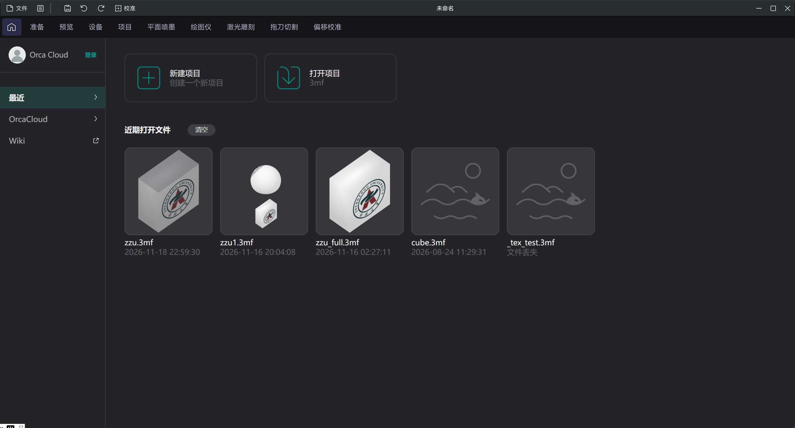
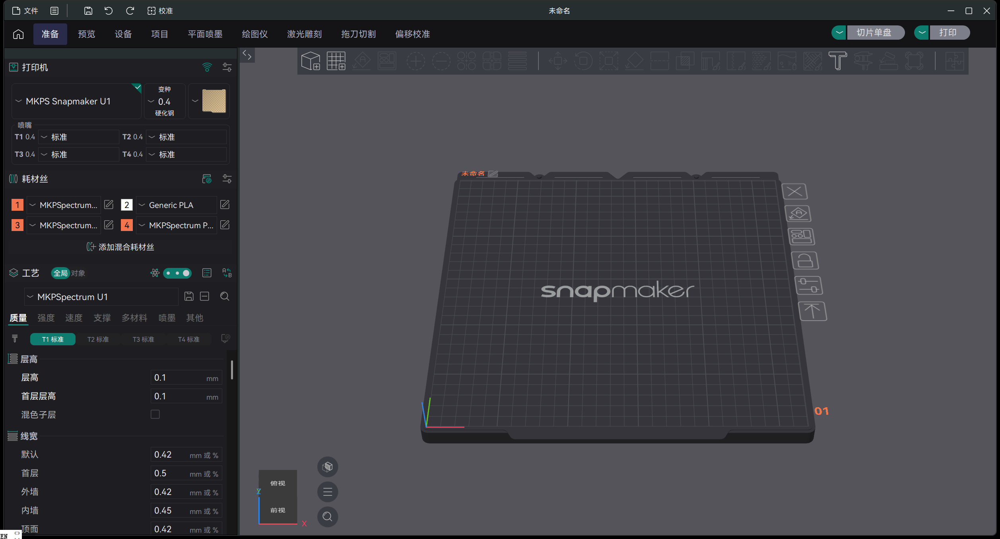
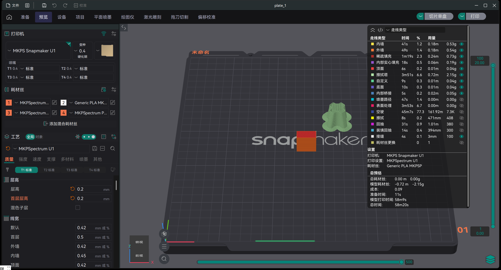
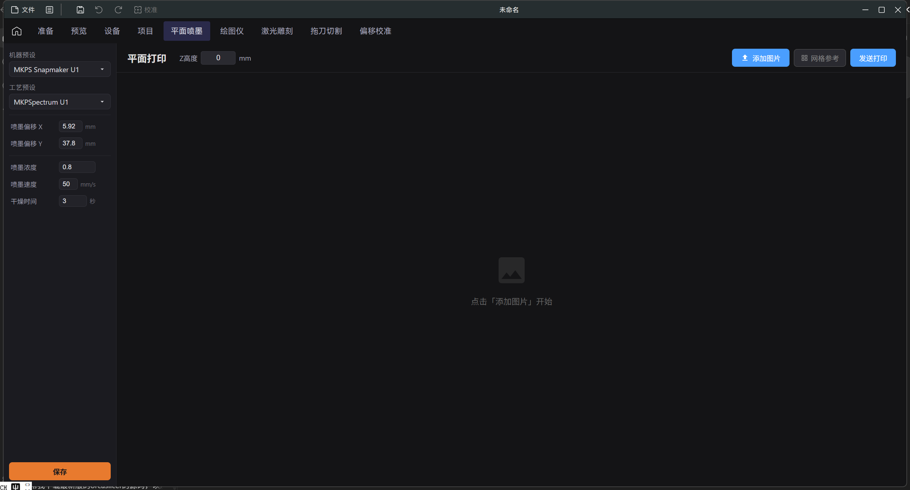
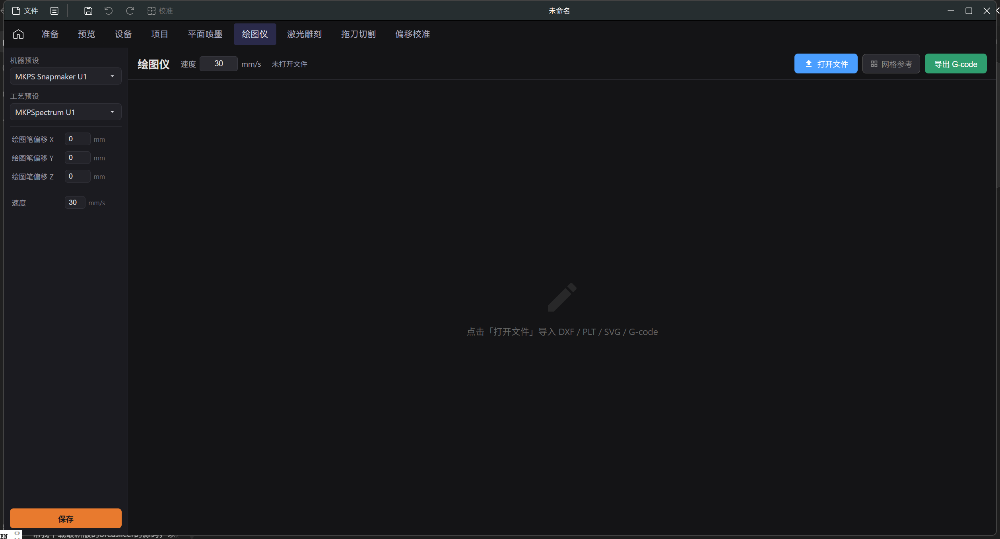
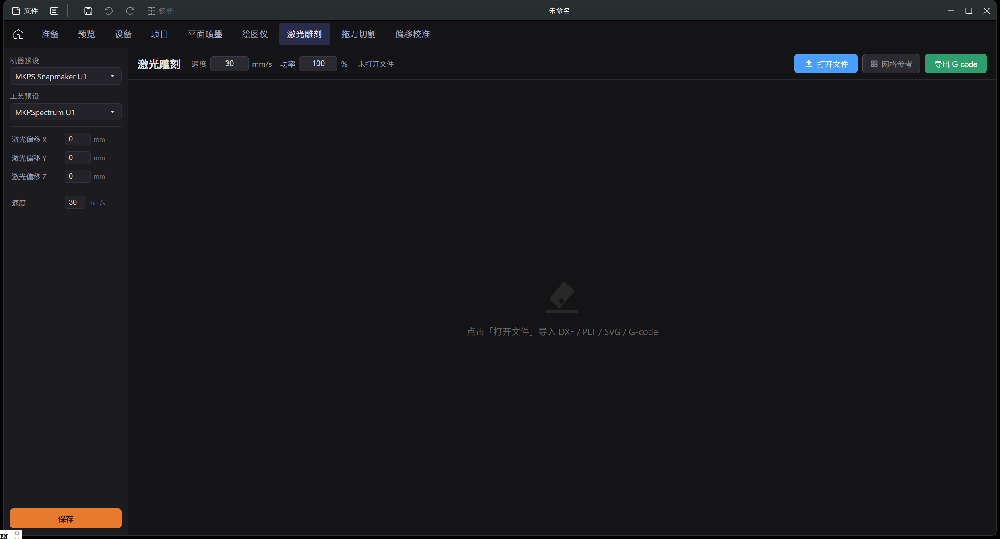
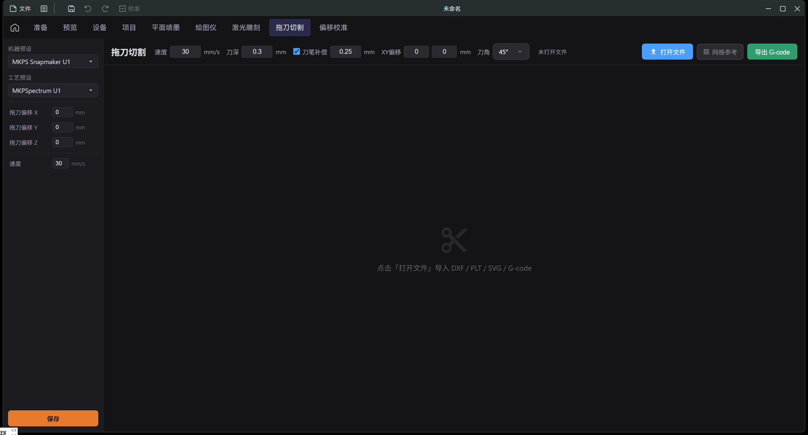
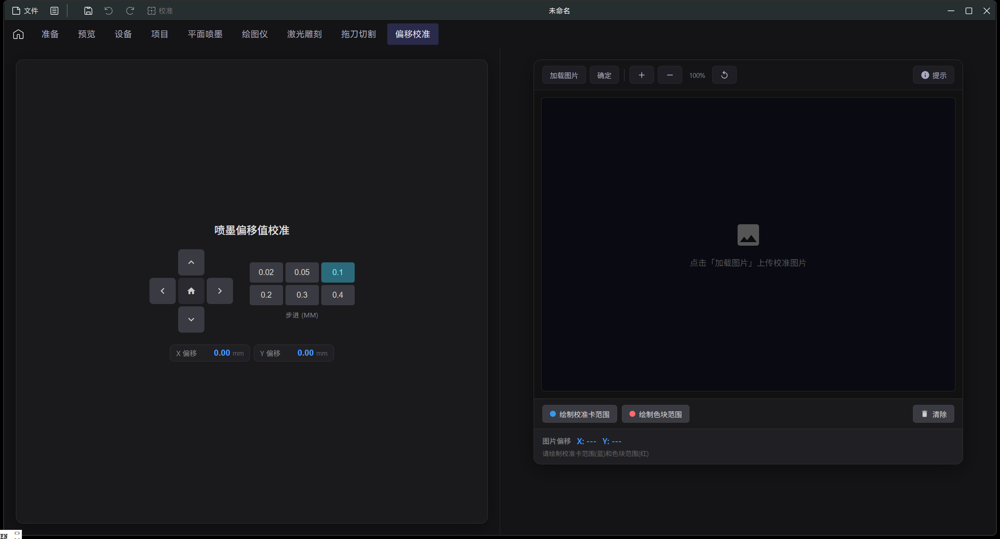
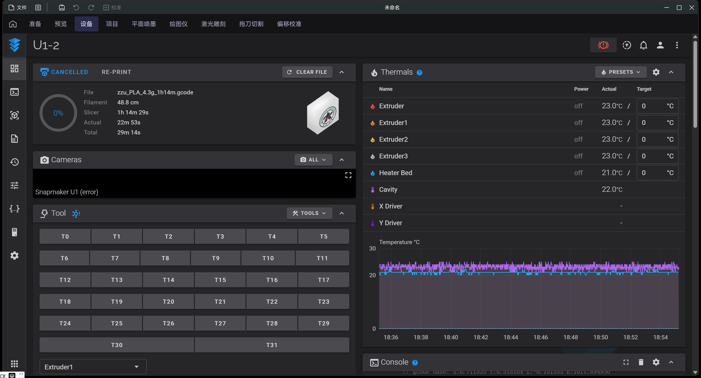

  

# MKPSpectrum

MKPSpectrum 是基于 **OrcaSlicer 2.5.0** 定制的全彩 FDM 打印软件，面向**喷墨彩色打印**这一整类场景：切片内核、参数体系和三维预览沿用 Orca 的既有实现，定制集中在喷墨控制、专用作业页面与多工具头偏移。当前适配 **Snapmaker U1 + mBrush 喷墨模组**；后续将换用自研 PCB 喷墨控制板，并把支持扩展到 Bambu Lab A1、A1 mini、P1 等主流机型。

- 当前版本：**v2.6.2**（[发行版](https://github.com/YZcat2023/MKPSpectrum/releases/tag/v2.6.2)）
- 上游基线：OrcaSlicer v2.5.0（commit `40ecc66f`）
- 旧 Python 版源码保留在 [`legacy-python`](https://github.com/YZcat2023/MKPSpectrum/tree/legacy-python) 分支

## 兼容性与路线图

- **当前适配**：Snapmaker U1，含 mBrush 喷墨模组与笔刷 / 绘图笔 / 拖刀 / 激光五类工具头
- **硬件演进**：自研喷墨控制 PCB 替代 mBrush 模组，沿用同一套喷墨参数、校准流程与作业页面
- **机型扩展**：Bambu Lab A1、A1 mini、P1 系列等主流 FDM 机型，按机型补齐预设、可打印区域与工具头偏移
- **不变的目标**：喷墨上色、平面喷墨与扩展工具共用同一套切片、预览与发送流程

## 一台机器能做的五类作业

| 作业 | 入口 | 说明 |
|---|---|---|
| 彩色 3D 打印 | 准备 / 预览 | 上表面生成吸墨排线，再由喷墨头上色 |
| 平面喷墨 | 平面喷墨 | 在纸面直接喷印图片，可调 Z 高度与套准 |
| 绘图仪 | 绘图仪 | 用绘图笔沿 DXF / PLT / SVG 线条输出 |
| 激光雕刻 | 激光雕刻 | 速度与功率成对调节，按轮廓烧刻 |
| 拖刀切割 | 拖刀切割 | 沿轮廓切开片材，不切底板 |

顶部标签依次为「准备」「预览」「设备」「项目」「平面喷墨」「绘图仪」「激光雕刻」「拖刀切割」「偏移校准」。左侧是打印机、耗材与工艺参数，右侧是三维工作区。

## 界面

### 项目页

启动后可直接新建项目或打开最近的项目；工程保存为 3MF，模型、摆放与全部参数都会一起带走。

### 准备页

左上角确认打印机预设 **MKPS Snapmaker U1**、变种与喷嘴；导入 3MF / STL / STEP 后在工作区摆放。喷墨作业对朝向敏感：**需要上色的面必须朝上**，表面处理只在上表面生成排线。

### 预览页

右侧「走线类型」把「喷墨路径」与「表面处理」单独列出，可分别显示或隐藏；拖动左侧滑块逐层检查首层、悬空与换层位置。模型较高时开启「擦嘴塔与模型等高」，避免高处换色空走。

### 平面喷墨

左侧设置喷墨偏移 X/Y、浓度、速度与干燥时间，右侧画布添加图片、按实际尺寸缩放，并用网格对齐纸张。Z 高度是喷头到纸面的距离，换纸厚必须同步调整；发送前确认「设备」页已连上目标 U1。

### 绘图仪 / 激光雕刻 / 拖刀切割

三页版式一致，都支持 DXF、PLT、SVG 与 G-code，**图形单位必须是毫米**。激光页额外提供功率百分比，速度提高时要同步提高功率；拖刀与绘图笔依靠各自的 Z 偏移决定压纸深度，换头后先在小块废料上试一次。

### 偏移校准

左半区用方向键加六档步进（0.02 / 0.05 / 0.1 / 0.2 / 0.3 / 0.4 mm）手调喷墨偏移；右半区加载实拍照片，框出模型外框与色块实际位置反算偏移。校准值只是当前会话的修正，确认后要写回打印机设置的「喷墨偏移 / 笔刷偏移 / 绘图笔偏移 / 拖刀偏移 / 激光偏移」，保存预设后才对下次打印生效。

### 设备页

显示当前任务、耗材用量与预计时间、摄像头画面、各工具头温度、热床与腔体温度、工具头列表与控制台。已上传的文件可在历史列表重新打印，顶部 RE-PRINT 用于重复上一次任务。

## 喷墨工艺参数

在「准备」页左侧工艺栏切到「喷墨」，共三组参数：

- **表面处理**：把上表面换成按间距排列的走线，形成能吸墨的纹理面；间距越小纹理越细、吸墨越多。
- **喷墨**：浓度、速度、重复遍数与干燥时间。浓度决定单位面积出墨量，速度决定单位时间走多远；重复喷墨必须留足干燥时间，否则会积墨。
- **色调调节**：分别调整 C / M / Y 墨量，以及鲜艳度、明亮度、对比度和平行四边形剪切；它只改颜色，不改几何。

调参顺序建议：先用试片确定出墨量与表面处理，再用 C / M / Y 修颜色，两个变量不要同时改。

## 与上游 OrcaSlicer 的差异

- 新增「项目 / 平面喷墨 / 绘图仪 / 激光雕刻 / 拖刀切割 / 偏移校准」等专用页面（`src/slic3r/GUI/MkpWebPage.*`、`src/libslic3r/MkpInkjet.*`）
- G-code、擦料塔与工具排序适配五工具头：逐层换色、内壁 / 外壁工具分配、擦嘴塔与模型等高
- GLB 纹理管线：`GlbBake`、`xatlas`、`meshoptimizer` 与 110 / 140 着色器
- Snapmaker U1 机型与材料预设、界面资源、zh_CN 本地化

## 快速开始

1. 安装并启动，进入「准备」，打印机选 **MKPS Snapmaker U1**，确认变种与实际机器一致。
2. 在「设备」页添加 U1 地址并连接，确认温度与工具头状态。
3. 导入模型并摆放，需要上色的面朝上。
4. 工艺栏切到「喷墨」，设置表面处理与喷墨参数后点「切片单盘」。
5. 在「预览」检查喷墨路径与表面处理，确认擦嘴塔高度后导出 G-code 或直接发送打印。

## 构建

源码位于本仓库根目录，与上游 OrcaSlicer 工程结构一致：

- Windows：`build_win.bat`（Visual Studio 2026 BuildTools / MSVC v145，CMake 4.4+，Perl）
- 依赖包缓存在 `deps/DL_CACHE/<组件名>/`，`deps/CMakeLists.txt` 会自动取用
- 产物：`build/src/Release/orca-slicer.exe`

上游构建说明见 [`README.OrcaSlicer-upstream.md`](README.OrcaSlicer-upstream.md)。

## 许可与致谢

MKPSpectrum 基于 [OrcaSlicer](https://github.com/OrcaSlicer/OrcaSlicer)（SoftFever 分支），遵循 **AGPL-3.0** 许可；本仓库的修改同样按 AGPL-3.0 发布，完整许可证见 [`LICENSE.txt`](LICENSE.txt)。感谢 Bambu Studio、PrusaSlicer、Slic3r 等上游项目。